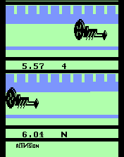

# dragster-breakdown

**What is the fastest legal time in Atari 2600 *Dragster*?** This project answers that by
searching every possible input sequence against the game's own code.

**Answer: 5.57 seconds.** A 5.51 (the long-disputed 1982 record) or even a 5.54 cannot be reached.



▶ [`media/dragster_5.57_run.mp4`](media/dragster_5.57_run.mp4): the optimal run, recorded from MAME (headless) with the inputs injected by script.

## Result

| Timer steps | Displayed time | Best margin vs. finish line* |
|---:|---:|---:|
| 165 | 5.51 | −408 |
| 166 | 5.54 | −155 |
| **167** | **5.57** | **+98** |

\* Distance units are 1/256 of a position step; the finish line is position `$61` (24 832 units).
Margins are for the best start phase (see below). Even a perfect driver reaches 5.51 about
1.6 position steps short of the line.

The clock adds 0.0334 s per player step, so the three times above are exactly 165, 166 and 167
steps. The best case is 167 steps. Some start phases (set by *when* Reset is pressed) need 168 (5.61).

This agrees with the independent analysis by Omnigamer (Eric Koziel), whose BizHawk TAS reports
5.57 with **98** spare units. This project's search produces exactly that margin. See
[Credits](#credits-and-prior-work).

## How it works

1. **Read the game.** The ROM's logic is small: each frame services one player (`X = $81 & 1`);
   RPM, speed and position follow a few rules (see [docs/FINDINGS.md](docs/FINDINGS.md)).
2. **Check legality.** Shifting before the countdown ends, or blowing the engine, makes the game draw
   `EARLY` / `BLOWN` in place of the time. No time can be read, so those runs are excluded.
   (A greedy "rolling start" appears to finish in 4.27 s but displays `EARLY`.)
3. **Model it.** [`dragster/model.py`](dragster/model.py) is a reduced model of player 0's physics.
   [`dragster/difftest.py`](dragster/difftest.py) checks it against the real ROM step by step
   (running in py65 with stubbed hardware): zero mismatches.
4. **Search exhaustively.** [`dragster/search.py`](dragster/search.py) is a layered BFS over (fire, clutch)
   per step. Distance never feeds back into the dynamics, so for equal other state the larger distance
   dominates; the pruning is exact and the first finishing layer is the true minimum, for all 16 start configurations.
5. **Replay in an independent emulator.** [`mame/replay.py`](mame/replay.py) injects the optimal inputs
   into MAME's Atari 2600 driver through a Lua script and reads the time the game itself computes.

## Reproduce

You need your own dump of the ROM (it is copyrighted and **not included**). The dump used here has:

```
size   2048 bytes
SHA-1  944c52de85464070a946813b050518977750e939
```

```sh
python -m venv .venv && . .venv/bin/activate
pip install -r requirements.txt

export DRAGSTER_ROM=/path/to/Dragster.bin      # or pass --rom
python -m dragster.difftest --trials 60        # model vs ROM, expect 0 mismatches
python -m dragster.search                      # all 16 start configurations
python -m dragster.margin                      # distance margins per start phase
```

MAME replay (needs `mame` with the `a2600` driver; `ffmpeg` only for video):

```sh
python mame/replay.py --rom "$DRAGSTER_ROM"
python mame/replay.py --rom "$DRAGSTER_ROM" --snapshot media/final_screen_5.57.png
python mame/replay.py --rom "$DRAGSTER_ROM" --video media/dragster_5.57_run.mp4
```

It runs MAME headless (`SDL_VIDEODRIVER=dummy`), so no window opens.

## Limits of the claim

- This shows 5.51 is impossible **in this ROM's modeled physics**, not why a 1982 score was recorded as 5.51.
  A different ROM revision, or a mis-transcribed score, are outside what the code can say.
- Inputs are assumed frame-perfect. Real play can only be slower.
- The 1-player rules are modeled. Odd game numbers add a tilt mechanic that, by reading the code, only
  slows the car; it is not modeled. Player 1's lane is argued symmetric, not tested.
- The optimal move list is not unique. The search reports one of the optimal sequences.
- Tested against one ROM dump and MAME 0.289. The BizHawk TAS result cited above is independent corroboration.

## Credits and prior work

- **Omnigamer (Eric Koziel)** disassembled the game and published a tool-assisted run with a 5.57
  in-game time ([TASVideos #5517](https://tasvideos.org/5517S)); the original solution is credited there to
  Reddit user **Kragnir**. Their analysis is what Twin Galaxies relied on, following a dispute filed by
  **Dick Moreland**. This project **independently reproduces the 5.57 floor from the same ROM**; it does not discover it.
- **Ben Heck's** team tried to reproduce 5.51 on original hardware and could not.
- *Dragster* is by **David Crane** (Activision, 1980).

## Provenance

This project was built by a human directing **Claude Code** (Claude Sonnet 5.5, an AI assistant from
Anthropic). The human set the question and reviewed the work; Claude did the reverse engineering, the model, the
search and the scripts, and ran every check described above.

## Legal

Not affiliated with or endorsed by Activision. No game code or disassembly is included; the ROM is
identified by hash only. Code is MIT-licensed (see [LICENSE](LICENSE)). The video and screenshot show output
from the game running in an emulator.
