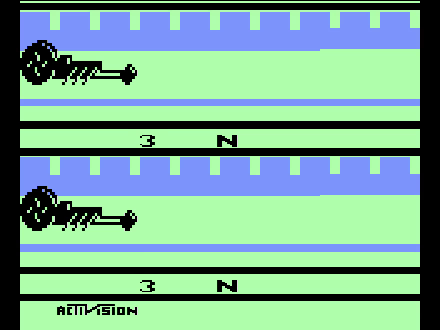

# dragster-breakdown

This project finds the fastest legal time in Atari 2600 *Dragster* by searching every possible input sequence
against the game's own code.

The fastest legal time is **5.57 seconds**. The game's code makes 5.51, the long-disputed 1982 record, and 5.54 unreachable.



The optimal run, recorded from MAME (headless) with the inputs injected by script. The bottom lane is an idle
second car whose clock keeps running. The full recording, with sound, is
[`media/dragster_5.57_run.mp4`](media/dragster_5.57_run.mp4).

## Result

| Timer steps | Displayed time | Best margin vs. finish line* |
|---:|---:|---:|
| 165 | 5.51 | −408 |
| 166 | 5.54 | −155 |
| **167** | **5.57** | **+98** |

\* Distance units are 1/256 of a position step, and the finish line is position `$61` (24 832 units).
Margins are for the best start phase (see below). In 165 steps a perfect driver ends about
1.6 position steps short of the line.

The clock adds 0.0334 s per player step, so 5.51, 5.54 and 5.57 correspond to 165, 166 and 167 steps.
The best case is 167 steps. Some start phases (set by *when* Reset is pressed) need 168 (5.61).

Omnigamer (Eric Koziel) published a BizHawk TAS that reaches 5.57 with **98** spare units, and this project's
search produces the same margin. See [Credits](#credits-and-prior-work).

## How it works

1. **Read the game.** The ROM's logic is small. Each frame services one player (`X = $81 & 1`), and
   RPM, speed and position follow a few rules (see [docs/FINDINGS.md](docs/FINDINGS.md)).
2. **Check legality.** Shifting before the countdown ends, or blowing the engine, makes the game draw
   `EARLY` / `BLOWN` in place of the time. No time can be read, so the search excludes those runs.
   A greedy "rolling start" appears to finish in 4.27 s but displays `EARLY`.
3. **Model it.** [`dragster/model.py`](dragster/model.py) is a reduced model of player 0's physics.
   [`dragster/difftest.py`](dragster/difftest.py) checks it against the real ROM step by step
   (running in py65 with stubbed hardware) and finds zero mismatches.
4. **Search every input.** [`dragster/search.py`](dragster/search.py) runs a layered BFS over (fire, clutch)
   per step. Distance never feeds back into the dynamics, so a state with more distance dominates an
   otherwise identical one. The pruning is exact, and the first layer with a finisher gives the true minimum
   for all 16 start configurations.
5. **Replay in a separate emulator.** [`mame/replay.py`](mame/replay.py) injects the optimal inputs
   into MAME's Atari 2600 driver through a Lua script and reads the time the game computes.

## Reproduce

You need your own dump of the ROM. It is copyrighted and **not included**. The checks cover two dumps,
both 2048 bytes:

| Release | SHA-1 | MD5 |
|---|---|---|
| NTSC | `944c52de85464070a946813b050518977750e939` | `77057d9d14b99e465ea9e29783af0ae3` |
| PAL | `2fdad16a60cd3a49d3bdfb301b3590f2aaa71da3` | `0c54811cf3b1f1573c9164d5f19eca65` |

The MD5 values match the [TASVideos](https://tasvideos.org/Games/1910) entry (NTSC) and
[Stella's database](https://github.com/stella-emu/stella/blob/master/src/emucore/DefProps.hxx) (PAL).

```sh
python -m venv .venv && . .venv/bin/activate
pip install -r requirements.txt

export DRAGSTER_ROM=/path/to/Dragster.bin      # or pass --rom
python -m dragster.difftest --trials 60        # model vs ROM, expect 0 mismatches
python -m dragster.optcheck                    # optimal moves on the real ROM, all 16 starts
python -m dragster.search                      # all 16 start configurations
python -m dragster.margin                      # distance margins per start phase
```

MAME replay (needs `mame` with the `a2600` driver, and `ffmpeg` for video). Add `--driver a2600p` for the PAL ROM:

```sh
python mame/replay.py --rom "$DRAGSTER_ROM"
python mame/replay.py --rom "$DRAGSTER_ROM" --snapshot media/final_screen_5.57.png
python mame/replay.py --rom "$DRAGSTER_ROM" --video media/dragster_5.57_run.mp4
```

MAME runs headless (`SDL_VIDEODRIVER=dummy`), so no window opens.

## Limits of the claim

- The search shows 5.51 is impossible in this ROM's modeled physics. It does not explain why a 1982 score
  was recorded as 5.51. A different ROM revision or a mis-transcribed score would lie outside what the code can say.
- The search assumes frame-perfect inputs. Real play cannot be faster.
- The model covers the 1-player rules. Odd game numbers add a tilt mechanic that appears to slow the car,
  and the model omits it. Player 1's lane is argued symmetric and untested.
- Several move lists are optimal, and the search reports one.
- The checks cover the NTSC and PAL dumps and MAME 0.289. Both dumps give 5.57 with the same physics. Only a
  third release with different code could change the result, and none appeared in the sources checked. The
  BizHawk TAS cited above corroborates the result from a separate emulator.

## Credits and prior work

- **Omnigamer (Eric Koziel)** disassembled the game and published a tool-assisted run with a 5.57
  in-game time ([TASVideos #5517](https://tasvideos.org/5517S)). That page credits the original solution to
  Reddit user **Kragnir**. Twin Galaxies relied on this analysis after **Dick Moreland** filed a dispute.
  This project reproduces the 5.57 floor from the same ROM with its own model and search.
- **Ben Heck's** team tried to reproduce 5.51 on original hardware and could not.
- *Dragster* is by **David Crane** (Activision, 1980).

## Provenance

A human directed **Claude Code** (Claude Sonnet 5.5, an AI assistant from Anthropic) to build this project.
The human set the question and reviewed the work. Claude did the reverse engineering, the model, the
search and the scripts, and ran every check described above.

## Legal

This project has no affiliation with Activision and no endorsement from it. The repository contains no game code
or disassembly and identifies the ROM by hash. The code uses the MIT license (see [LICENSE](LICENSE)).
The video and screenshot show output from the game running in an emulator.
